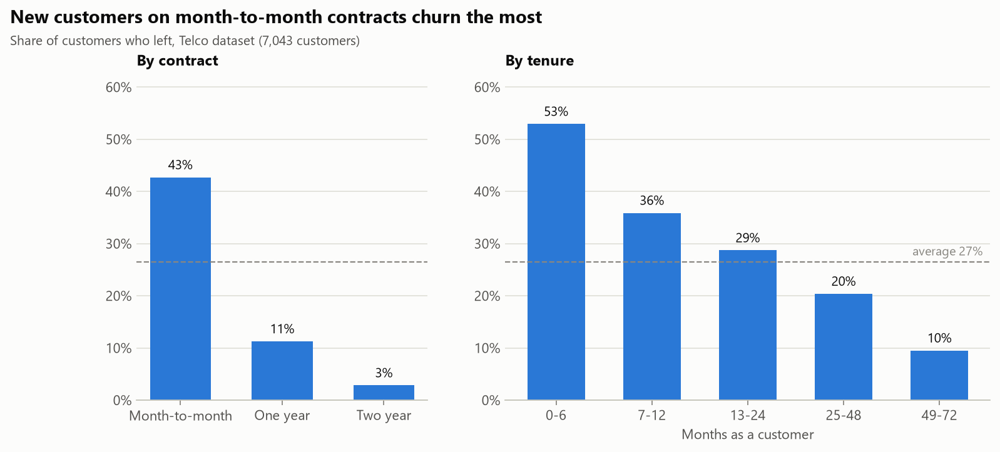
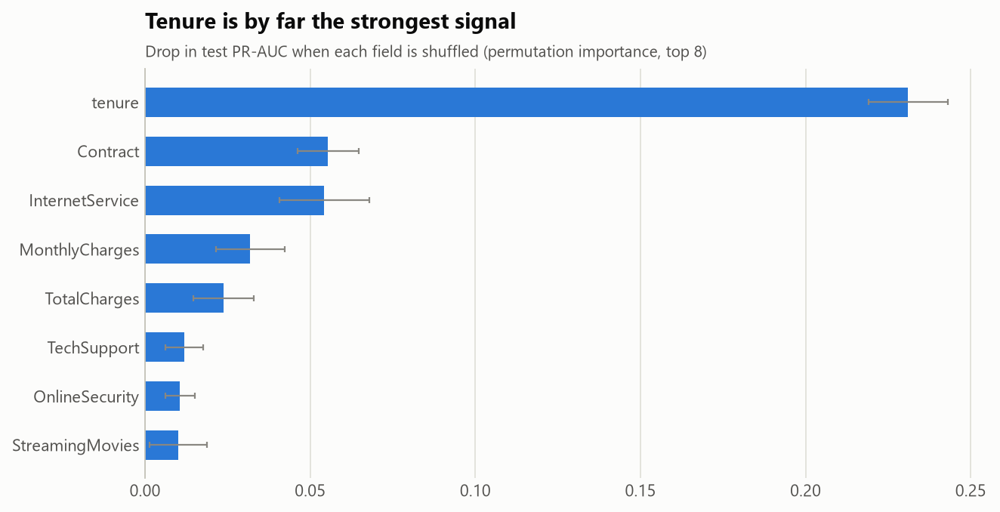
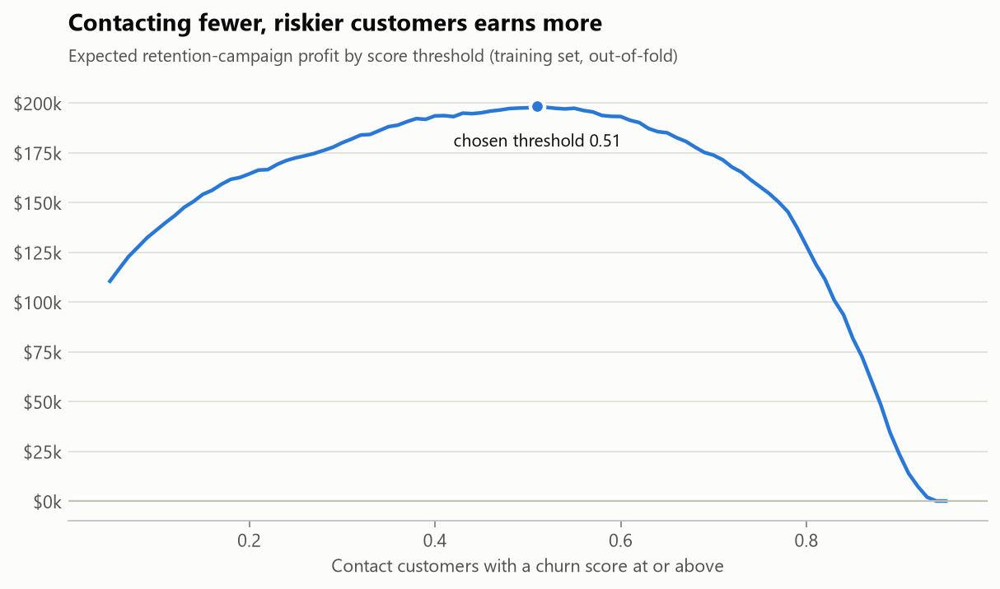

# Customer Churn Prediction with a Live Retention App

Predicts which telecom customers are about to leave, and turns the prediction into a decision: **who should get a retention offer so that the campaign makes money.** It includes a deployed Streamlit app that scores one customer or a whole file.

### [▶ Try the live app](https://telco-churn-fochakos.streamlit.app)

## Results (held-out test set, 1,409 customers)

| | Value |
|---|---|
| ROC-AUC | **0.842** |
| PR-AUC | **0.634** (chance = 0.265) |
| Churners caught (recall) | **78%** (291 of 374) |
| Contacted customers who would have churned (precision) | 51% |
| Customers contacted | 40.5% |
| Expected campaign profit | **$46,051**, vs. $13,434 for offering everyone a discount (**3.4×**) |

The decision threshold (0.51) was chosen to maximise expected profit, using cross-validated predictions on the training set only, then applied once to the test set.

## Why customers leave



- **Contract type:** 43% of month-to-month customers churn, against 11% on one-year and 3% on two-year contracts.
- **Tenure:** 53% of customers in their first 6 months leave, against 10% after four years. Tenure is by far the strongest single signal in the model.
- **Service and billing:** fiber-optic customers (42%), electronic-check payers (45%), customers without tech support (42%) and senior citizens (42%) churn well above the 27% average.
- **Revenue at stake:** churners account for **30% of monthly revenue** ($139k of $456k).



## From score to decision

A churn score alone doesn't say who to contact. Each retention offer has a cost, and only some at-risk customers will stay because of it. The campaign is modeled with three explicit assumptions, all set at the top of [`src/train.py`](src/train.py):

| Assumption | Value |
|---|---|
| Cost of one retention offer | $60 (about one month's bill) |
| Share of would-be churners the offer keeps | 30% |
| Value of a kept customer | 12 months of their monthly charge |

Expected profit of contacting a customer = P(churn) × 30% × 12 × monthly charge − $60. Sweeping the threshold shows that contacting fewer, higher-risk customers beats contacting everyone:



The curve is fairly flat between about 0.35 and 0.60. A team could therefore move the threshold to fit its call-centre capacity without losing much profit.

## Approach

1. **Data quality:** 7,043 customers, no duplicate IDs. `TotalCharges` is text because 11 brand-new customers (tenure 0) have a blank value; they haven't been billed yet, so it's set to 0. `SeniorCitizen` is 0/1 while every other yes/no field is text, so it was made consistent.
2. **Split first:** stratified 80/20 train/test split (seed 42). All preprocessing (scaling, one-hot encoding) sits inside a scikit-learn `Pipeline`, so nothing from the test set leaks into training.
3. **Model comparison** with 5-fold stratified cross-validation on the training set:

| Model | CV ROC-AUC | CV PR-AUC |
|---|---|---|
| Baseline (always "stay") | 0.500 | 0.265 |
| **Logistic regression** (selected) | **0.845** | **0.657** |
| Random forest | 0.847 | 0.657 |
| Gradient boosting | 0.843 | 0.656 |

   The three real models perform the same. **Logistic regression was kept** because it gives each customer an explainable reason for their score, which the app shows.
4. **Threshold** chosen on out-of-fold training predictions to maximise campaign profit (see above).
5. **Interpretation:** permutation importance on the test set, plus logistic regression odds ratios ([`reports/odds_ratios.csv`](reports/odds_ratios.csv)). A month-to-month contract multiplies the odds of churning by 1.9 and fiber optic by 1.7, while a two-year contract roughly halves them.

## The app

[`app/streamlit_app.py`](app/streamlit_app.py) loads the saved pipeline and threshold and has three tabs:

- **Score a customer:** churn risk, a contact / no-action recommendation, the expected value of an offer, and the factors raising or lowering this customer's risk.
- **Score a list:** upload a CSV, get every customer scored and ranked, and download the result. A template CSV is provided.
- **How the model works:** test metrics, assumptions and charts.

## Limitations

- **Illustrative economics.** The offer cost, save rate and customer value are assumptions, not measured. A real campaign should estimate the save rate with an A/B test, then re-run the threshold search.
- **Overlapping features.** `TotalCharges` ≈ `tenure` × `MonthlyCharges`, so their individual coefficients aren't meaningful on their own (for example, monthly charges has an odds ratio below 1 once tenure and total charges are in the model). Predictions are unaffected; read these three together.
- **A single snapshot** of a fictional IBM sample company, with no dates. Churn can't be predicted ahead of time here, only explained after the fact; a production model would use features from before a cutoff date.
- **Calibration** isn't tuned. Class weighting makes the scores rank customers well, but they overstate absolute risk.

## How to run

Requires Python 3.11+.

```bash
pip install -r requirements.txt
```

1. Download the [Telco Customer Churn dataset](https://www.kaggle.com/datasets/blastchar/telco-customer-churn) from Kaggle and put `WA_Fn-UseC_-Telco-Customer-Churn.csv` in `data/`.
2. Run from the project root:

```bash
python src/train.py               # compares models, picks a threshold, saves models/churn_model.joblib
python src/charts.py              # draws reports/figures/*.png
streamlit run app/streamlit_app.py
```

The trained model (9 KB) is committed, so the app runs without retraining.

## Project structure

```
├── app/streamlit_app.py      # the deployed app
├── src/
│   ├── data.py               # loading and cleaning
│   ├── train.py              # CV comparison, threshold, test evaluation, saved model
│   └── charts.py             # README charts
├── models/churn_model.joblib # pipeline + threshold + assumptions + test metrics
├── reports/                  # CV results, metrics, odds ratios, importance, figures
└── data/                     # raw CSV (not committed)
```

## Tools

Python · pandas · scikit-learn · Streamlit · Matplotlib
